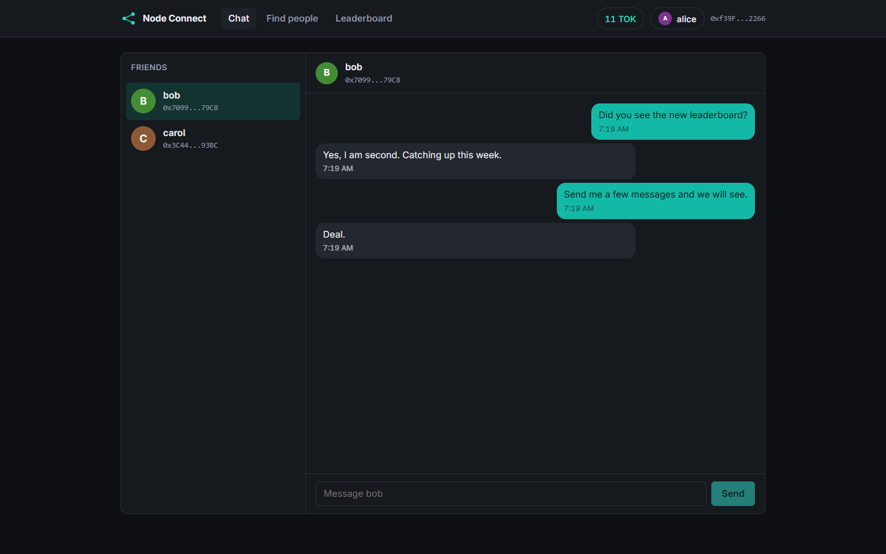
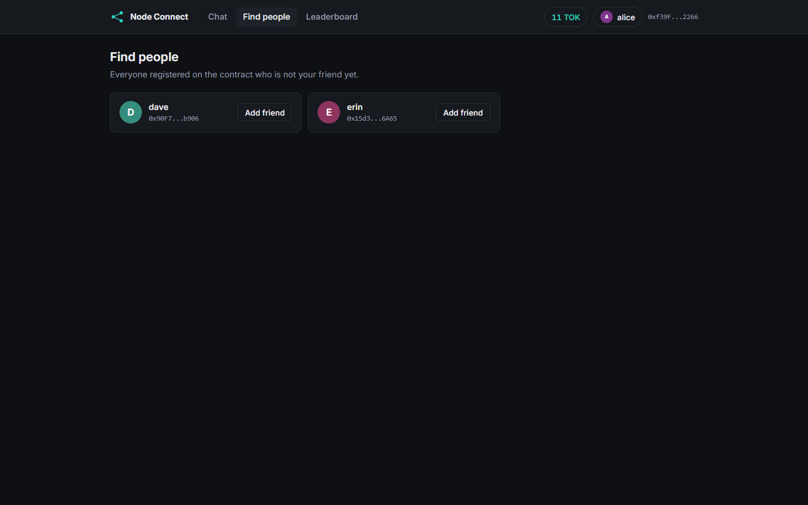
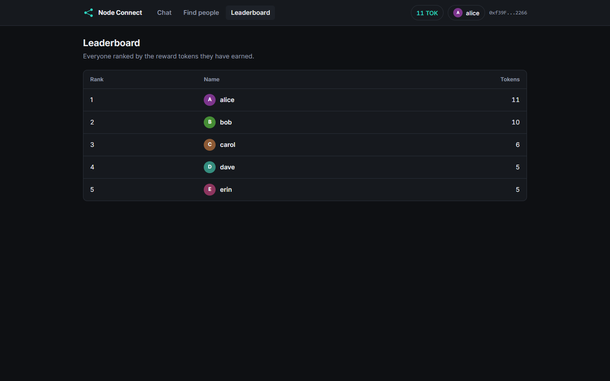
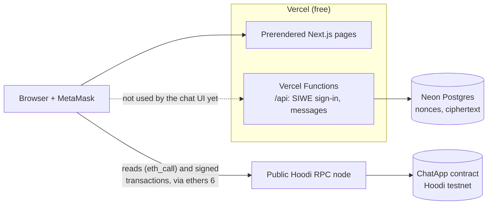
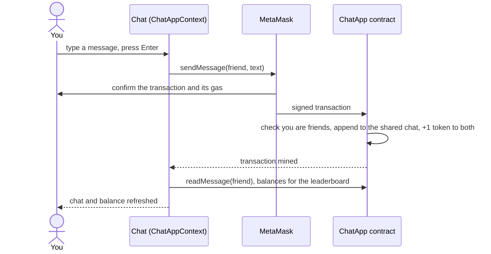

<p align="center">
  
</p>

<h1 align="center">Node Connect</h1>

<p align="center">
  A chat app whose whole backend is one Ethereum smart contract.<br>
  Sign in with MetaMask, add friends and chat; every account, friendship and message is a transaction that earns both sides tokens.
</p>

<p align="center">
  <a href="https://node-connect-sigma.vercel.app"><strong>Live demo</strong></a>
  &middot;
  <a href="#try-it-live">Try it</a>
  &middot;
  <a href="#how-it-works">How it works</a>
  &middot;
  <a href="#run-it-locally">Run locally</a>
  &middot;
  <a href="contracts/ChatApp.sol">The contract</a>
</p>

<p align="center">
  <a href="https://github.com/A-RYAN-1/node-connect/actions/workflows/ci.yml"></a>
  <a href="https://github.com/A-RYAN-1/node-connect/actions/workflows/uptime.yml"></a>
  
  
  
  
  
  
</p>

<p align="center">
  <a href="https://node-connect-sigma.vercel.app">
    
  </a>
</p>

<p align="center"><sub>Last updated: 2026-10-18 &middot; Live on Vercel (free), contract on the Hoodi testnet &middot; a full rework is planned (see <a href="#status-and-roadmap">roadmap</a>)</sub></p>

---

## Contents

- [About](#about)
- [Try it live](#try-it-live)
- [Features](#features)
- [Why it exists](#why-it-exists)
- [How it works](#how-it-works)
- [Engineering quality](#engineering-quality)
- [Run it locally](#run-it-locally)
- [Environment variables](#environment-variables)
- [Deployment](#deployment)
- [Status and roadmap](#status-and-roadmap)
- [Credits](#credits)

## About

Most chat apps keep your account and your messages on a company's servers. Node Connect keeps them
in a smart contract instead: your wallet address is your account, a friendship is recorded on chain
for both people, and each message is appended to the chat the two of you share. Today the chat UI
has no server and no database: the pages are static files that talk to the contract through MetaMask.
A small backend (sign-in with your wallet and an encrypted message store) is built and documented but
not wired into the UI yet.

To make activity worth something, the contract pays tokens: 5 for creating an account, 1 to each
side for a friendship and 1 to each side for every message. A leaderboard ranks everyone by tokens.

## Try it live

Open **https://node-connect-sigma.vercel.app** in a browser with the
[MetaMask](https://metamask.io) extension. Every action is a transaction on the Hoodi testnet, so
the account needs a little Hoodi ETH, which is free from a faucet such as the
[Google Cloud faucet](https://cloud.google.com/application/web3/faucet/ethereum/hoodi) or the
[PoW faucet](https://hoodi-faucet.pk910.de/).

> MetaMask currently warns that the site and its contract are high risk. The live contract was
> deployed from a wallet whose key leaked, and wallet security services flag everything that wallet
> created. Redeploying from a fresh wallet is the first step of the rework (see
> [Known limitations](#status-and-roadmap)). To try the app without that warning, use the
> [local chain](#run-it-locally); it needs no testnet ETH either.

Things to try in the first two minutes:

1. **Connect Wallet** and approve the network switch: the app adds Hoodi to MetaMask if it is missing.
2. **Create an account** with a username: the header balance shows 5 TOK once the transaction is mined.
3. Open **Find people** and add someone: both of you get 1 TOK, and they appear in your friends list.
4. Open the chat with that friend and **send a message** (Enter sends): both balances go up by 1.
5. Open the **Leaderboard** to see everyone ranked by tokens.

<table>
  <tr>
    <td width="50%"><p align="center"><sub>Registered users you can add, read from the contract (<a href="#the-contract">how friendships work</a>)</sub></p></td>
    <td width="50%"><p align="center"><sub>Everyone ranked by tokens (<a href="#the-contract">the reward rules</a>)</sub></p></td>
  </tr>
</table>

<sub>Screenshots: the production build of this commit on a local Hardhat chain seeded with demo
accounts (alice, bob, carol, dave, erin), 1440x900, 2026-10-21. The live site shows the same
screens for Hoodi accounts.</sub>

## Features

- **Wallet sign-in**: MetaMask connects the account; the app switches MetaMask to the configured
  network and adds it when missing.
- **On-chain accounts**: one username per address, stored in the contract.
- **Friends**: add any registered user; the friendship is written for both sides.
- **Chat**: messages between friends are stored on chain in one shared chat per pair, oldest first,
  and the chat reloads when a sent message is mined.
- **Token rewards**: the contract pays 5 tokens per account, 1 to both sides per friendship and 1 to
  both sides per message; the header shows your balance.
- **Leaderboard** of every user ranked by tokens.
- **Messages API** (built, not yet used by the chat UI): sign in with your wallet (EIP-4361), then store and read
  encrypted messages over HTTP; documented at `/api/docs`.
- **Local chain mode**: the same app runs against a Hardhat node with test accounts, no testnet ETH
  needed.

## Why it exists

It started as a final-year project to learn how a dApp is built end to end: a Solidity contract, its
tests, a deploy to a public testnet and a frontend that talks to it through a wallet. Bringing it up
to date in 2026 (Next.js 16, ethers 6, Hoodi after Holesky was retired, CI) taught the rest: a leaked
deployer key does not stop mattering when the file is deleted, and putting everything on chain makes
every click cost a wallet confirmation and every message public.

## How it works



What happens when you send a message:



The page holds no state of its own beyond what it read last: after each mined transaction,
`Context/ChatAppContext.js` reads the account, friends, chat and balances from the contract again.

### The contract

[`contracts/ChatApp.sol`](contracts/ChatApp.sol) is the whole backend.

| Call | Who can call it | Effect | Tokens |
|---|---|---|---|
| `createAccount(name)` | an address without an account; the name must not be empty | stores the username | +5 to you |
| `addFriend(address, name)` | a registered user, for another registered user who is not already a friend and not themselves | adds the friendship to both lists | +1 to both |
| `sendMessage(friend, text)` | friends only | appends to the chat keyed by the hash of both addresses | +1 to both |
| `readMessage(friend)` | anyone (`eth_call`) | returns the chat, oldest first | - |
| `getAllAppUser()`, `getMyFriendList()`, `getUsername(address)` | anyone (`eth_call`) | read accounts and friends | - |
| `mineMessageSafe(friend, nonce)` | anyone | +1 when `keccak(chat, last message, nonce)` is below a fixed target; not used by the UI | +1 to the caller |

Tokens are a balance kept inside the contract (`minerReward`), not an ERC-20 token, so they do not
show up in a wallet.

### The rework contracts (iteration 1, deployed on Hoodi 2026-10-18)

Four new contracts replace `ChatApp.sol` step by step; the site still uses `ChatApp` until the
frontend moves in a later iteration. All source is verified on Blockscout.

| Contract | Address | What it does |
|---|---|---|
| `NodeToken` (TOK) | [`0xC6a2...09b0`](https://eth-hoodi.blockscout.com/address/0xC6a2fbCB19E29371a35Bf721559902843F6e09b0) | ERC-20, hard cap of 21M, minted only by `Mining`, no admin |
| `Registry` | [`0x6c03...1802`](https://eth-hoodi.blockscout.com/address/0x6c03e1B8273F0Dd3A6d4d7E28B21d15Ad9e71802) | profiles with an encryption key; friend request, accept, decline, remove, block |
| `ChatAnchor` | [`0x7604...f4cF`](https://eth-hoodi.blockscout.com/address/0x7604755AeA3D48b90F6b585bCD8333AF7Dbff4cF) | daily epochs; the relayer posts one Merkle root of activity per finished epoch |
| `Mining` | [`0xcB3e...661f`](https://eth-hoodi.blockscout.com/address/0xcB3e522516E30436358D0622874BE358C0ea661f) | claim TOK with a Merkle proof of activity plus a proof-of-work nonce |

Mining rules: at least 5 messages to one accepted friend in the epoch; the nonce hash covers the
caller, so nobody can reuse another's work; one claim per user per epoch and at most 100 per epoch;
accounts must be a day old; 50 TOK per claim, halved every 90 epochs; the target retargets from the
previous epoch's claims (aim: 10) within a factor of 16; only the epoch just ended is claimable;
every failure reverts. Deployer and relayer are separate wallets (addresses in
[`deployments/hoodi.json`](deployments/hoodi.json)); the relayer is trusted to post true roots
until the batch is published for recomputation (iteration 2).

### Tech stack

| Layer | Technology |
|---|---|
| Smart contract | Solidity 0.8.19, Hardhat 2 (compile, local node, tests, deploy) |
| Frontend | Next.js 16 (pages router), React 18, CSS Modules |
| Backend | Vercel Functions (Next.js `pages/api`), Sign-In with Ethereum (`siwe`), httpOnly cookie sessions (`iron-session`), Neon Postgres (`@neondatabase/serverless`), OpenAPI 3 with Swagger UI |
| Chain access | ethers 6 through MetaMask (`BrowserProvider`) |
| Network | Ethereum Hoodi testnet (chain 560048); a local Hardhat node (chain 1337) for development |
| Tests and checks | Hardhat tests (Mocha, Chai), API tests (`node:test`), ESLint (Next.js rules), an ABI freshness check |
| CI and hosting | GitHub Actions (CI on every push, daily uptime check), Vercel Hobby |
| Local setup | Node 22 pinned with mise |

### Design decisions

1. **The contract is the whole backend.** No server to run or pay for, and no one can edit the
   history. Trade-off: every write needs a wallet confirmation and gas, and everything stored is
   public, messages included.
2. **Prerendered pages on Vercel.** The pages are files, so they are free to host and fast (Lighthouse
   performance 99 on desktop). The chat UI has no server to index data, so the leaderboard makes one
   call per user and sorts in the browser; the new `/api` Functions are the start of fixing that.
3. **Reads go through the user's wallet.** One provider for reads and writes keeps the code small.
   Trade-off: without MetaMask the app cannot show any data.
4. **Configuration is checked in one place at build time.** `Context/config.js` stops the build when
   the contract address or network is missing or malformed, so a bad deploy never goes live.
5. **The contract ABI is a checked-in file, kept fresh by CI.** The frontend imports
   `Context/ChatApp.json`, and CI fails when it differs from the compiled contract.

<details>
<summary><strong>Project structure</strong></summary>

```
contracts/ChatApp.sol      the smart contract (accounts, friends, messages, rewards)
test/ChatApp.test.js       contract tests (Hardhat)
scripts/deploy.js          deploys the contract; export-abi.js copies the ABI to Context/
Context/config.js          reads and checks every environment variable (the only place that does)
Context/networks.js        networks MetaMask can be switched to (hoodi, sepolia, localhost)
Context/ChatAppContext.js  app state, read again from the contract after each mined transaction
Utils/apiFeature.js        MetaMask connection and the contract instance
Components/                NavBar, Friend list and Chat, UserCard, Model (create account), Error
pages/                     / (chat), /alluser (add friends), /leaderboard
.github/workflows/         ci.yml (lint, tests, ABI check, build), uptime.yml (daily)
```

</details>

## Engineering quality

| Area | What is in place |
|---|---|
| Tests | 49 Hardhat tests, all passing on 2026-10-18: the 9 of `ChatApp`, plus the rework contracts (claim, replay, binding to the sender, cap, retarget, halving, every revert; registry and anchor rules; token cap and minter) |
| CI | GitHub Actions on every push: ESLint, the contract tests, Slither (0 findings, the timestamp detector excluded because epochs are time-based), a check that `Context/ChatApp.json` matches the compiled contract, and the production build |
| Uptime | A daily workflow requests `/`, `/alluser` and `/leaderboard` on the live site and fails unless each answers 200 with the app |
| API | Sign-In with Ethereum (EIP-4361): single-use nonces that expire in 5 minutes, message domain and chain checked, session in an httpOnly SameSite=Lax cookie; the messages API accepts only base64 ciphertext, caps it at 4096 characters and rate limits 30 messages per minute per address; every response carries a request id and JSON logs hold no message content. 17 API tests pass against Neon and 18 against the in-memory store (2026-10-23) |
| Security | No secrets in the frontend (only public `NEXT_PUBLIC_` values); the deployer key lives only in a local `.env`; security headers from `vercel.json` (`nosniff`, `DENY` framing, referrer and permissions policies) |
| Measured | Lighthouse on the live site, 2026-10-12 (mobile / desktop): performance 89-90 / 99, accessibility 100 / 100, best practices 100 / 100, SEO 100 / 100 |
| Dependencies | `npm audit --omit=dev` (what ships to the browser) reports no vulnerabilities; the remaining findings are in Hardhat's development toolchain |

Run them:

```bash
npm run lint      # ESLint
npm test          # contract tests
npm run test:api  # API tests (add STORE=neon DATABASE_URL=... to run against Neon)
npm run slither   # static analysis (pip install slither-analyzer solc-select)
npm run build     # production build
```

## Run it locally

Works on Windows (Git Bash), macOS and Linux. You need **Git**, **Node 22** (pinned in `mise.toml`;
[mise](https://mise.jdx.dev) installs it) and the **MetaMask** browser extension.

```bash
git clone https://github.com/A-RYAN-1/node-connect.git
cd node-connect
mise install            # skip if you manage Node another way
npm ci
cp .env.example .env    # the defaults point at the public Hoodi contract
npm run dev
```

Open `http://localhost:3000`, connect MetaMask and approve the switch to Hoodi. Writes need a little
Hoodi ETH from a faucet (see [Try it live](#try-it-live)).

**On a local chain** (no testnet ETH, no MetaMask warning):

```bash
npm run node            # terminal 1: Hardhat node on http://127.0.0.1:8545 with funded test accounts
npm run deploy-local    # terminal 2: deploys the contract and prints its address
```

In `.env`, set `NEXT_PUBLIC_CONTRACT_ADDRESS` to the printed address and `NEXT_PUBLIC_NETWORK=localhost`,
run `npm run dev`, and import one of the test accounts `npm run node` prints into MetaMask. Those
accounts and keys are public and only for the local chain.

<details>
<summary><strong>Deploy your own contract to Hoodi</strong></summary>

1. Create a fresh MetaMask account that will only ever hold testnet ETH, and fund it from a Hoodi
   faucet.
2. Put its private key in `.env` as `DEPLOYER_PRIVATE_KEY` (optionally an Alchemy or Infura URL as
   `HOODI_RPC_URL`).
3. Run `npm run deploy` and set `NEXT_PUBLIC_CONTRACT_ADDRESS` to the address it prints.
4. If you changed the contract, run `npm run abi` so the frontend uses the new ABI.

</details>

<details>
<summary><strong>Troubleshooting</strong></summary>

- **The build stops with a config error.** `Context/config.js` checks the variables; copy
  `.env.example` to `.env` (or set them on the host) and build again.
- **MetaMask shows the wrong network.** Click Connect Wallet again and approve the network switch.
- **A transaction fails with "insufficient funds".** The account needs a little Hoodi ETH.
- **Local chain: MetaMask reports a nonce error after restarting `npm run node`.** The chain was
  reset; in MetaMask, Settings, Advanced, clear the activity data for that account.
- **`npm ci` fails on Node 18 or 20.** The project needs Node 22 (`mise install`).

</details>

## Environment variables

All of them are listed with comments in [`.env.example`](.env.example).

| Variable | What it is | Needed |
|---|---|---|
| `NEXT_PUBLIC_CONTRACT_ADDRESS` | Address of the deployed `ChatApp` contract. Public. | app (build time) |
| `NEXT_PUBLIC_NETWORK` | Network MetaMask is switched to: `hoodi`, `sepolia` or `localhost` (`Context/networks.js`). Public. | app (build time) |
| `HOODI_RPC_URL` | Hoodi RPC URL; defaults to the free public node | `npm run deploy`, optional |
| `DEPLOYER_PRIVATE_KEY` | Key of a testnet-only deployer wallet. Secret: only in your local `.env`, never on the host | `npm run deploy` |
| `DATABASE_URL` | Neon Postgres connection string. Secret. | API, `npm run db:migrate` |
| `SESSION_SECRET` | 32+ random characters encrypting the session cookie. Secret. | API |
| `SIWE_ALLOWED_DOMAINS` | Host(s) a sign-in message may name, for example `node-connect-sigma.vercel.app` | API (required in production) |
| `SIWE_CHAIN_ID`, `MESSAGES_PER_MINUTE` | Optional overrides (defaults: 560048, 30) | API, optional |

`NEXT_PUBLIC_` values are compiled into the public JavaScript, so they must never hold a secret.
Never commit a real `.env` file; only `.env.example` is tracked.

## Deployment

The site and its API run on Vercel's free Hobby plan (pages are prerendered, `pages/api` becomes Vercel Functions), with the messages in a free Neon Postgres database; the contract lives on the Hoodi testnet at
[`0x8e4BBf86322Ab47D7cd2c6E313eEa72da328510C`](https://eth-hoodi.blockscout.com/address/0x8e4BBf86322Ab47D7cd2c6E313eEa72da328510C).

| Part | Where it runs | How it deploys | Variables it needs |
|---|---|---|---|
| Website | Vercel Hobby (free), https://node-connect-sigma.vercel.app | automatically on every push to `main` (Vercel Git integration; checked 2026-10-16) | `NEXT_PUBLIC_CONTRACT_ADDRESS`, `NEXT_PUBLIC_NETWORK`, `DATABASE_URL`, `SESSION_SECRET`, `SIWE_ALLOWED_DOMAINS` (Production and Preview) |
| Contract | Hoodi testnet | by hand, `npm run deploy` from a local `.env`; never from CI | `DEPLOYER_PRIVATE_KEY`, optional `HOODI_RPC_URL` (local only) |

What a visitor notices (checked 2026-10-16): the site itself has no cold start; every write waits for
a Hoodi block and needs test ETH from a faucet; the public RPC node is shared and can be slow at
times.

<details>
<summary><strong>Host your own copy on Vercel</strong></summary>

1. Import the repository in Vercel (framework: Next.js, no root directory).
2. Create a free Neon database (Vercel Storage), run `npm run db:migrate` once with its `DATABASE_URL`,
   and set `NEXT_PUBLIC_CONTRACT_ADDRESS`, `NEXT_PUBLIC_NETWORK`, `DATABASE_URL`, `SESSION_SECRET` and
   `SIWE_ALLOWED_DOMAINS` in the project's Environment Variables for Production and Preview.
3. Deploy. `vercel.json` adds the security headers; `.vercelignore` keeps env files and build output
   out of CLI uploads.

</details>

## Status and roadmap

**Reached:** production baseline on 2026-10-12 (Next.js 16 and ethers 6, contract tests, lint and
build in CI, checked configuration, security headers, a daily uptime check, the Lighthouse scores
above), and auto-deploy on push since 2026-10-16. Checked by hand on the live site on 2026-10-13:
adding a friend and sending a message on Hoodi.

**Known limitations**

- Messages in the chat UI are still stored as plain text on a public chain: anyone can read any chat. The new messages API stores ciphertext only; the UI moves to it, with encryption, in the next step. The API does not yet check that two addresses are friends on chain.
- Tokens are a balance inside the contract, not an ERC-20, and the rewards can be farmed with two
  accounts of your own. `mineMessageSafe` can be called again for the same message, so it is not
  safe to wire into the UI.
- Adding a friend needs no consent from the other person, and there is no way to remove or block.
- Every action costs a MetaMask confirmation and gas, then a wait for the block.
- The leaderboard makes one call per user; lists such as `getAllAppUser` grow without a limit.
- UI: the CHAT tab stays highlighted on every page, friend addresses are shown clipped without
  `0x`, every friend gets the same avatar, and the GIFs in `assets/` weigh about 14 MB.

**Planned: the rework** (agreed 2026-10-13; each step merged and deployed before the next)

- [x] Contracts and tests (done 2026-10-18, deployed and verified from a fresh wallet; the site switches in a later step): an OpenZeppelin ERC-20 token (TOK) with a hard cap, a registry with
      friend requests (request, accept, decline, remove, block), deployed and verified from a fresh
      wallet, which should also end the MetaMask warning
- [x] Backend on Vercel Functions and Neon (built 2026-10-23): Sign-In with Ethereum, a messages API that
      stores only ciphertext, OpenAPI at `/api/openapi.json` and Swagger UI at `/api/docs`; the chat UI
      does not use it yet (next step). Still to do: the scheduled job that anchors each day's message hashes on chain
- [ ] End-to-end encrypted chats (keys derived from one wallet signature) and a new chat UI with
      pending and failed states
- [ ] Real token mining: proof of activity plus proof of work, one claim per user per day, bound to
      the sender, with retargeting and halving; mined in a Web Worker
- [ ] Production checks again (Slither in CI, API tests, Lighthouse), then this README

## Credits

Built by **Aryan Deshmukh** ([A-RYAN-1](https://github.com/A-RYAN-1)): the contract, its tests, the
frontend, and the 2026 upgrade (Hoodi, Next.js 16, ethers 6, CI, deployment).
[RealFalseGod](https://github.com/RealFalseGod) contributed the leaderboard page and the token
balance in the header (October 2025).
